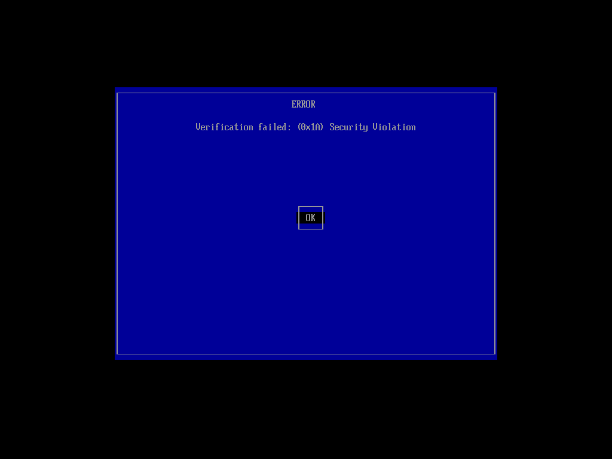
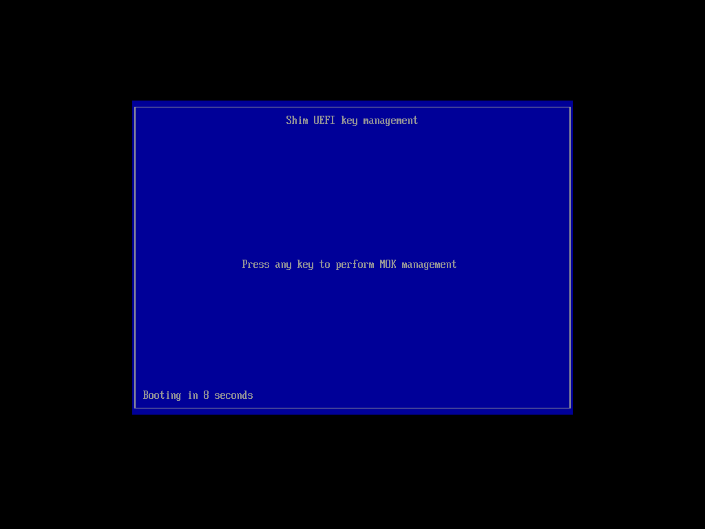
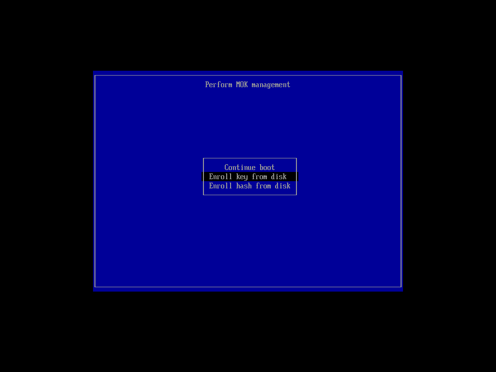
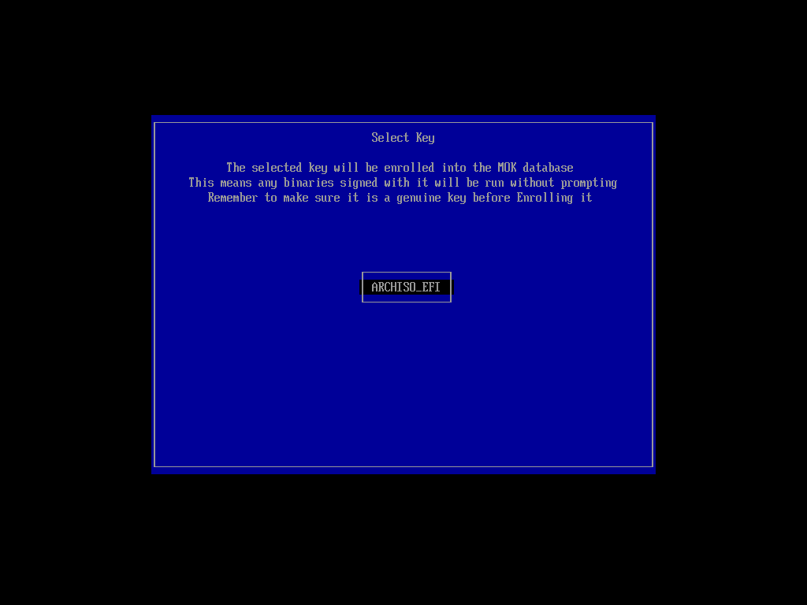
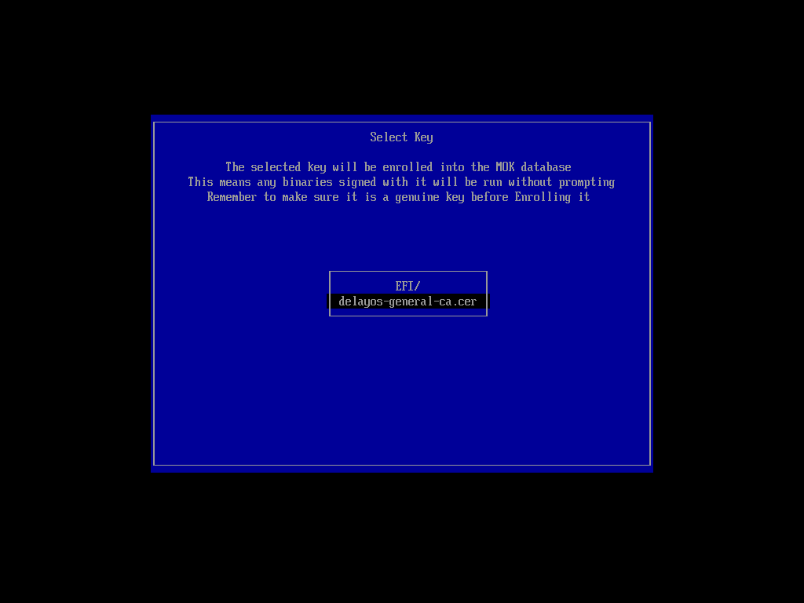
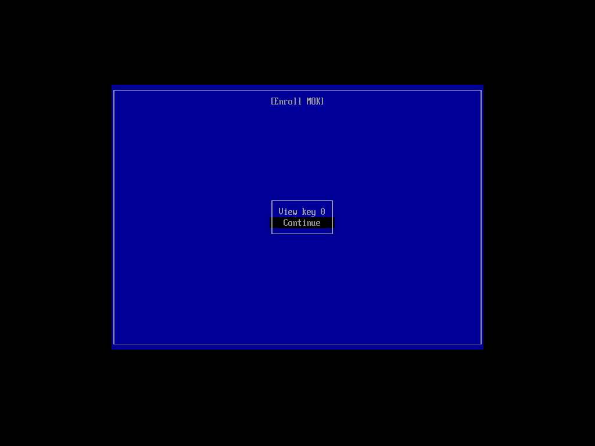
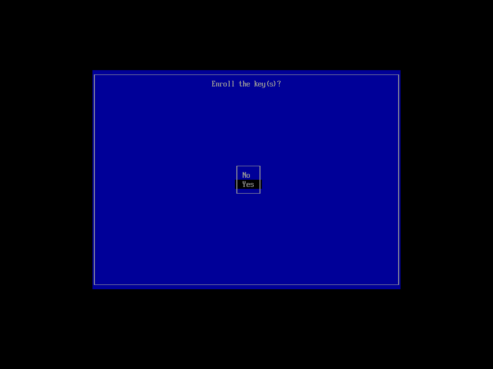
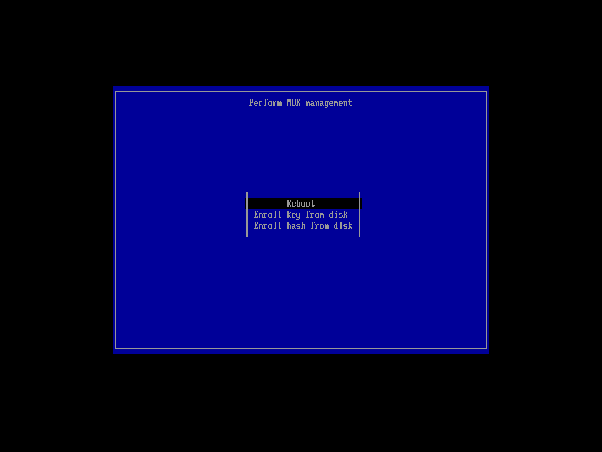

# Secure Boot를 켠 채로 DelayOS 쓰기

DelayOS 설치 USB(ISO)와 설치된 DelayOS는 **UEFI Secure Boot를 켠 상태에서 그대로 부팅됩니다.**
BIOS 설정에 들어가 Secure Boot를 껐다 켰다 할 필요가 없습니다.

대신 PC마다 **처음 한 번만**, 파란 화면에서 "이 PC는 DelayOS의 서명을 믿는다"고 등록해 주어야 합니다(1분 정도).
한 번 등록하면 그 PC에서는 설치 USB도, 설치된 DelayOS도, 나중에 다시 만든 USB도 묻지 않고 부팅됩니다.

> Secure Boot가 꺼져 있는 PC, 옛 BIOS(레거시) 방식 PC에서는 이 문서의 등록 과정이 나오지 않고 예전처럼 바로 부팅됩니다.

## 처음 부팅할 때: DelayOS 키 등록 (PC마다 한 번)

Secure Boot가 켜진 PC에 DelayOS USB를 꽂고 USB로 부팅하면 DelayOS 대신 아래 화면이 나옵니다. 고장이 아니라,
아직 이 PC가 DelayOS의 키를 모르기 때문입니다. 화면은 영어이고 키보드(방향키, Enter)로만 조작합니다.

**1. `Verification failed: (0x1A) Security Violation` 이 나오면 Enter (`OK`)**



**2. `Shim UEFI key management` 화면에서 아무 키나 누릅니다** (10초 안에. 놓치면 PC가 다시 시작되고 1번부터 다시 나옵니다.)



**3. `Enroll key from disk` 를 고르고 Enter**



**4. 목록에서 DelayOS USB(`ARCHISO_EFI`)를 고르고, `delayos-general-ca.cer` 파일을 고릅니다**





**5. `Continue` → `Yes` → `Reboot`**







PC가 다시 시작되고, 이번에는 DelayOS가 부팅됩니다. 암호는 묻지 않습니다.

요약하면: **Enter → 아무 키 → `Enroll key from disk` → USB의 `delayos-general-ca.cer` → `Continue` → `Yes` → `Reboot`.**

### 그다음에는

- 이 USB로 DelayOS를 **설치하면, 설치된 DelayOS도 Secure Boot를 켠 채로 부팅됩니다.** 같은 키를 쓰므로 등록 화면이 다시 나오지 않습니다.
  "Windows 게임 지원"(보이지 않는 Windows)을 함께 설치해도 마찬가지입니다. 설치 뒤에 BIOS에서 할 일이 없습니다.
- 확인: 터미널에서 `mokutil --sb-state` → `SecureBoot enabled`.
- 등록을 지우려면: `sudo mokutil --delete /usr/share/delayos/secureboot/general/delayos-general-ca.cer` 후 다시 시작(파란 화면에서 확인).
  지운 뒤에는 Secure Boot를 켠 채로 DelayOS가 부팅되지 않습니다.

### 자주 묻는 것

| 상황 | 해결 |
|---|---|
| 파란 화면 없이 "Secure Boot Violation", "Invalid signature" 같은 제조사 메시지만 나오고 멈춤 | 그 PC의 펌웨어가 Microsoft의 "3rd Party UEFI CA"를 믿지 않도록 설정되어 있습니다(일부 노트북의 기본값: Lenovo "Allow Microsoft 3rd Party UEFI CA", Dell/HP/Surface의 비슷한 항목). BIOS에서 그 항목을 켜세요. Secure Boot 자체는 켠 채로 둡니다. |
| 4번에서 USB가 목록에 여러 개 보임 | `ARCHISO_EFI`라고 적힌 것(또는 USB 장치 경로)을 고릅니다. 맨 위 폴더에 `delayos-general-ca.cer`가 보이면 맞습니다. Rufus의 "ISO 모드"나 파일 복사로 만든 USB는 USB 이름(`DELAYOS_…`) 아래 맨 위 폴더에 있습니다. |
| 실수로 `Continue boot`를 눌렀음 | 등록되지 않은 채로 다시 "Verification failed"가 나옵니다. 1번부터 다시 하면 됩니다. |
| 등록했는데도 "Verification failed"가 계속 나옴 | BIOS 업데이트나 "키 초기화(Restore factory keys)"를 하면 등록이 지워질 수 있습니다. 다시 등록하세요. 그래도 안 되면 아래 "SBAT" 항목을 보세요. |
| Ventoy로 만든 USB | Ventoy 자체의 Secure Boot 등록(Ventoy 문서의 "Enroll Key")을 먼저 해야 하고, 그 뒤 DelayOS는 Ventoy의 방식으로 부팅됩니다. Secure Boot를 켠 채로 쓰려면 Rufus(DD 모드)·balenaEtcher·`dd`로 만든 USB를 권장합니다. |
| EAC Linux v2(안티치트 모드)를 쓰려는 경우 | Epic의 규칙상 일반 키가 등록되어 있으면 조건을 채울 수 없습니다. [windows-switch.md](windows-switch.md)의 "Secure Boot" 절을 보세요. |

## 어떻게 동작하나

DelayOS는 Microsoft가 직접 서명해 준 부트로더가 없으므로, 대부분의 배포판처럼 **shim + MOK** 방식을 씁니다.

```
펌웨어 (Microsoft UEFI CA를 신뢰)
  └─ \EFI\BOOT\BOOTx64.EFI   shim (Microsoft 서명, shim-signed 패키지의 Fedora shim)
       ├─ \EFI\BOOT\mmx64.efi   MokManager (키 등록 화면)
       └─ \EFI\BOOT\grubx64.efi  GRUB (DelayOS 일반 키로 서명, SBAT 포함, 모듈 내장, TPM 측정)
            └─ /arch/boot/x86_64/vmlinuz-linux-delayos   커널 (DelayOS 일반 키로 서명. GRUB이 shim을 통해 검증)
                 └─ initramfs → 라이브 시스템 (initramfs와 squashfs는 서명 검증 대상이 아님: GRUB+shim의 일반적인 범위)
```

- shim은 GRUB을, GRUB은 커널을 **이 PC에 등록된 키(MOK)** 로 검증합니다. 위에서 등록한 `delayos-general-ca.cer`가 그 키(공개 인증서)입니다.
- 설치 USB와 설치된 시스템은 **같은 서명 파일**(`delayos-sb-general` 패키지의 `grubx64.efi`와 서명된 커널)을 씁니다. 그래서 등록은 PC마다 한 번입니다.
- USB에는 공개 인증서만 들어 있습니다. 서명에 쓰는 개인 키는 빌드 서버에만 있고 저장소·ISO·패키지 어디에도 들어가지 않습니다.
- Secure Boot가 꺼진 UEFI에서는 같은 경로(shim → GRUB → 커널)가 검증 없이 그대로 부팅됩니다. BIOS(레거시)에서는 예전처럼 syslinux로 부팅합니다.
- 부팅 메뉴는 보이지 않고 바로 시작합니다(대기 시간 0). `Shift`를 누른 채로 부팅하면 한국어 메뉴(시작, UEFI 펌웨어 설정, 다시 시작, 끄기)가 나옵니다. 단, 키 상태를 알려 주는 펌웨어에서만 동작합니다(가상 머신에서는 확인하지 못했습니다).
- GRUB은 Secure Boot가 켜져 있으면(shim lock) 디스크의 글꼴 파일을 열지 않습니다(`prohibited by secure boot policy`). 그래서 한글 글꼴(GNU Unifont)과 작은 `grub.cfg`가 서명된 GRUB 이미지 안(memdisk)에 들어 있습니다. memdisk가 있는 이미지는 `prefix`가 `(memdisk)/boot/grub`로 시작하므로, 그 안의 `grub.cfg`가 부팅한 파티션의 `EFI/DelayOS/grub.cfg`로 넘겨 줍니다. 글꼴이 없던 2026.11.26 빌드에서는 Secure Boot를 켠 PC의 부팅 메뉴가 영어와 `?` 테두리로 나왔고, 설치 USB를 시작할 때 위 오류가 잠깐 보였습니다.

### 설치된 시스템

Secure Boot가 켜진 채로 설치하면 설치 프로그램(Calamares의 `delayos_winsetup` 단계 → `delay-winsetup sb-install`)이 부트로더 설치 직후에
`EFI/DelayOS/`와 `EFI/BOOT/`에 shim, MokManager, 서명된 GRUB, 인증서를 놓고, `/boot/vmlinuz-linux-delayos`를 서명된 이미지로 두고,
펌웨어 부팅 항목 "DelayOS"가 shim을 가리키게 합니다. 이 PC에 키가 이미 등록되어 있으면(`mokutil --test-key`) 등록 요청을 다시 넣지 않습니다.

- 커널이 업데이트되면 pacman 훅(`95-delay-sb-kernel.hook`)이 서명된 이미지를 다시 `/boot`에 놓습니다.
- 서명된 것은 `linux-delayos`뿐입니다. 예비 커널 `linux-lts`와 직접 설치한 커널은 Secure Boot를 켠 상태에서는 부팅되지 않습니다.
- Secure Boot를 **끈 채로** 설치한 PC는 예전처럼 서명 없는 GRUB으로 설치됩니다. 나중에 켜고 싶으면 `sudo delay-winsetup sb-setup`을 한 번 실행하세요
  (키가 등록되어 있지 않으면 다음 시작 때 파란 화면에서 `Enroll MOK` → `Continue` → `Yes` → 암호 `delayos` → `Reboot`).

## 빌드하는 사람을 위해

1. 일반 서명 키(한 번만): `sudo tools/make-delayos-general-key.sh` → `/root/delayos-keys/delayos-general-*`. CA 개인 키는 오프라인으로 옮깁니다. **키를 바꾸면 모든 사용자가 다시 등록해야 합니다.**
2. `sudo ./build.sh`. 키가 있으면:
   - `delayos-sb-general` 패키지를 만듭니다(서명된 GRUB과 커널, 공개 인증서). 개인 키는 이때만, 빌드 사용자의 임시 폴더에 복사되었다가 지워집니다.
   - `mkarchiso`가 만든 ISO를 `tools/iso-secureboot.sh`가 다시 씁니다: EFI 파티션 이미지를 shim + MokManager + 서명된 GRUB + `grub.cfg` + 인증서로 새로 만들고,
     ISO의 커널을 서명된 이미지로 바꾸고, `/delayos-general-ca.cer`를 넣습니다. BIOS 부팅(syslinux)과 볼륨 UUID·레이블은 그대로입니다. 이 단계에는 개인 키가 필요 없습니다.
   - 키가 없으면 경고를 내고 예전과 같은 ISO(Secure Boot를 꺼야 부팅)를 만듭니다. `shim-signed`(AUR)가 빌드되지 않았을 때도 같습니다.
3. 이미 만든 ISO에 나중에 적용할 수도 있습니다(그 ISO의 커널로 만든 `delayos-sb-general` 패키지가 있을 때):
   ```bash
   sudo tools/iso-secureboot.sh --iso delayos-YYYY.MM.DD-x86_64.iso --out delayos-sb.iso \
        --sb-pkg delayos-sb-general-*.pkg.tar.zst --shim-pkg shim-signed-bin-*.pkg.tar.zst \
        --opts "$(grep -o "^LIVE_OPTS='.*'" build.sh | cut -d"'" -f2)"
   ```
4. 확인: `sbverify --list` / `sbverify --cert delayos-general-ca.crt`로 `grubx64.efi`와 커널을, 가상 머신(Secure Boot 켬)에서 실제 부팅을 확인합니다.
   `delayos-sb-general`을 다시 만든 뒤에는 가상 머신(Secure Boot 켬)에서 (1) 키를 누르지 않았을 때 바로 부팅되는지(`grub>` 프롬프트에서 멈추면 memdisk의 `grub.cfg`가 빠진 것입니다), (2) Esc로 연 부팅 메뉴가 한글인지 꼭 확인합니다.

### SBAT (부트로더 폐기 목록)

shim은 GRUB에 들어 있는 SBAT 세대 번호가 PC에 저장된 폐기 수준(SbatLevel)보다 낮으면 실행을 거부합니다.

- Arch의 `/usr/share/grub/sbat.csv`는 `grub,4`라고 적혀 있지만, shim 16의 최신 수준(2025051000)은 `grub,5` 미만을 폐기합니다.
  `delayos-sb-general`은 GRUB이 스스로 알고 있는 세대(빌드 시점의 "Global SBAT level")를 적습니다. 빌드 로그의 `SBAT: this GRUB is generation N` 줄을 확인하세요.
- shim이나 GRUB을 올릴 때마다 가상 머신에서 `sudo mokutil --set-sbat-policy latest` 후 두 번 다시 시작해서(`mokutil --list-sbat-revocations`로 확인) 부팅되는지 봅니다.
- shim 자체가 폐기되면(새 SBAT 수준이 `shim,5` 이상을 요구) 새 `shim-signed`로 ISO를 다시 만들어야 합니다. 설치된 시스템은 `sudo delay-winsetup sb-setup`이 새 shim을 다시 놓습니다.

### 알려진 한계

- **Microsoft UEFI CA 2011 → 2023 전환:** shim이 어느 CA로 서명되었는지(`sbverify --list /usr/share/shim-signed/shimx64.efi`)에 따라, 2023 CA만 믿는 최신 PC나 2011 CA만 아는 오래된 PC에서 shim이 거부될 수 있습니다. 해결책은 BIOS 업데이트(새 CA 추가)입니다.
- "Microsoft 3rd Party UEFI CA"를 기본으로 꺼 둔 PC(Secured-core 노트북 등)는 BIOS에서 그 항목을 켜야 합니다. Secure Boot를 끄는 것은 아닙니다.
- 32비트 UEFI(64비트 CPU인 일부 태블릿)용 `BOOTIA32.EFI`는 서명 없는 GRUB입니다(그런 기기에는 Secure Boot 문제가 없습니다). 실제 기기에서 검증하지 못했습니다.
- initramfs와 커널 명령줄은 검증되지 않습니다(통합 커널 이미지 UKI가 아님). 일반 `linux-delayos`는 커널 잠금(lockdown)을 강제하지 않습니다. 이 구성의 목적은 "Secure Boot를 끄지 않아도 된다"이지 변조 방지 체인이 아닙니다.
